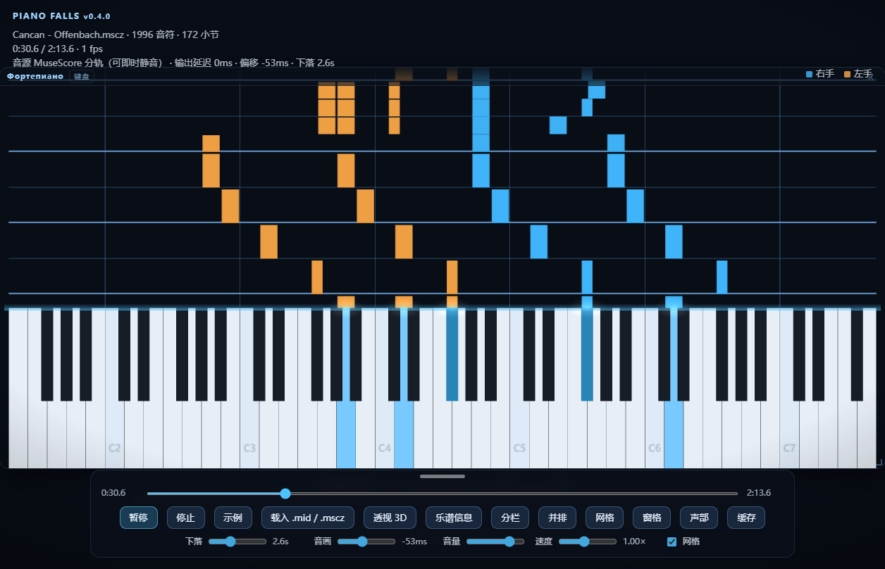

# Piano Falls

一个**直接读 MuseScore 工程文件**（`.mscz` / `.mscx`）、用**本机 MuseScore 渲染原谱音频**、
让画面和声音来自同一个播放引擎的钢琴瀑布流播放器。零构建，浏览器里跑。



它不是"又一个 MIDI 可视化"：走 MIDI 会把**乐器归属、谱表归属、左右手**丢掉，
而这正是"只画钢琴"、"两只手分开开关"、"小提琴单独一个指板窗格"的依据。

---

## 快速开始

**Windows（不用装任何东西）**

1. 装 [MuseScore 4](https://musescore.org/)（只有渲染音频/分轨要用；没有它也能跑，会退化成合成钢琴）
2. 双击 `启动 Piano Falls.cmd`
3. 浏览器打开 <http://127.0.0.1:8765/>，把 `.mscz` 拖进去

**任意平台（需要 Node 18+）**

```bash
npm start          # = node serve.mjs --open
```

`MuseScore` 不在默认位置时用环境变量指过去：

```bash
MUSESCORE_BIN="/path/to/mscore" node serve.mjs
PORT=9000 node serve.mjs
```

## 用法

| 操作 | 效果 |
|---|---|
| 空格 | 播放 / 暂停 |
| ← / → | ±5 秒（按住 Shift 是 ±1 秒） |
| ↑ / ↓ | 下落时长（音符从顶部落到琴键的时间） |
| Home | 回到开头 |
| 拖 `.mscz` / `.mid` 到窗口 | 载入乐谱 |

控制栏：播放、停止、示例、载入、3D、乐谱信息、分栏、并排、网格、窗格、声部、缓存；
底部是下落时长、音画偏移、音量、速度（0.25×–2.0×，**变速不变调**）。

## 做了什么

- **`.mscz` 直读**：zip → `.mscx` → 自己写的 XML 解析（无第三方依赖），保留乐器/谱表/声部归属
- **原谱音色**：调本机 MuseScore 命令行渲染 mp3 + MIDI，音频当播放时钟
- **左右手独立**：每只手可以单独显示/发声，还有"联动"开关
- **按谱表分轨**：把别的谱表的和弦换成等长休止符再渲一遍，得到每只手独立的音频，
  静音是**瞬时**的（不用重渲整首）
- **反复 / 1.2. 结尾 / `%` 小节重复 / 两音颤音 / 8va 八度线**：都按 MuseScore 的实际播放顺序展开
  （每个结论都有实测依据，见 [技术笔记](docs/technical-notes.md)）
- **音画自动校准**：用渲染音频的起音和第一个音对齐，得到毫秒级偏移
- **弦乐窗格**：小提琴/中提琴/大提琴/低音提琴的指板条，算弦号、把位、换弦
- **3D / 2D**、键盘布局 49/61/76/88 自动选、网格、渲染缓存（第二次打开秒开）

## 为什么音画能对上

四件事，缺一不可：

1. **音频是唯一时钟**：`<audio>.currentTime` 是权威，rAF 只读时间不累加 dt
2. **速度表仲裁**：谱面 tempo 和 MIDI tempo 各算一张 tick→秒 的表，用**解码出来的音频真实长度**当裁判选表
3. **音符长度用发音长度**：谱面时值 ≠ 实际响了多久（延音线/长音），以渲染 MIDI 的时值为准
4. **反复按演奏顺序展开**：不是按书面小节排，否则整首越走越歪

细节和实测数字都在 [docs/technical-notes.md](docs/technical-notes.md)。

## 目录

| 文件 | 职责 |
| --- | --- |
| `index.html` | import map、UI 外壳、CDN 失败兜底 |
| `src/version.js` | **版本号唯一来源**（`test/test-version.mjs` 会核对 package.json） |
| `src/xml.js` | 极简 XML 解析（浏览器/Node 共用） |
| `src/zip.js` | 读 zip（浏览器自带 `DecompressionStream`） |
| `src/mscx.js` | **.mscx 语义解析**：乐器/谱表/时值/三连音/连音线/tempo/反复/八度线/颤音 |
| `src/score.js` | tick→秒（分段 tempo）、乐器筛选、左右手、连音线合并 |
| `src/mscz.js` | `.mscz` → 音符流 + 渲染音频（走 `/render`） |
| `src/media-player.js` | `<audio>` 播放器：变速不变调、多轨对齐（只用 delay，不 seek） |
| `src/mute.js` | 按谱表静音：把和弦换成等长休止符再渲染 |
| `src/audio.js` | 合成钢琴兜底（Tone.Sampler + 采样 CDN） |
| `src/waterfall.js` | Three.js：2D 正交 / 3D 透视、键、音符条、网格、落点光晕 |
| `src/stage.js` / `src/panes.js` / `src/window.js` | 画布、自由窗格、通用窗口行为 |
| `src/lane-strings.js` / `src/instruments.js` | 弦乐指板条、定弦与指位换算 |
| `src/keyboard-layout.js` | 键盘几何（任意音域生成 + 尺寸自动选择） |
| `src/main.js` | 装配层：时钟、进度、控件、面板 |
| `serve.mjs` | 跨平台开发服务器（静态 + `/render`） |
| `serve.ps1` | Windows 零依赖服务器（和 `serve.mjs` 接口一致） |
| `tools/` | 自检脚本、诊断探针、快捷方式安装 |
| `test/` | 测试（合成谱面，不含任何第三方乐谱） |

## 测试

```bash
npm test              # = node tools/run-tests.mjs（自动发现 test/ 和 tools/ 下的测试）
npm run check         # 语法检查 src/*.js + serve.mjs + test/*
node tools/run-tests.mjs mscx    # 只跑名字里含 mscx 的
```

测试**不依赖任何真实乐谱**：`test/synth-fixtures.mjs` 现造合成谱面（弱起、倚音、三连音、
连音线、反复/结尾、`%`、颤音、八度线都在里面），所以可以随便公开和跑 CI。

## 改这个项目的时候

- **版本号只改两处**：`src/version.js` 和 `package.json`（测试会拦住不一致）。
  页面标题和 HUD 的版本号都从这里来，别再抄第三份。
- **不要写死路径**：MuseScore 用 `MUSESCORE_BIN`，端口用 `PORT`，脚本用参数/环境变量。
- **不要写死测试数据**：新测试优先用 `test/synth-fixtures.mjs` 的合成谱面。
- **加测试**：扔一个 `test/test-*.mjs` 进 `test/`，`npm test` 会自动跑到。
- **新依赖**：本项目刻意保持"零构建 + 少量 CDN 依赖"，加依赖前先想清楚是否必要。
- 页面开着的时候改了 `src/*.js`：`/version` 会变，页面会提示按 Ctrl+F5。

## 已知限制

- 需要 MuseScore 4 才能出原谱音色；没有就退化成合成钢琴（音高对、音色不对）
- 只画键盘乐器 + 弦乐指板；管乐/打击乐还没做
- 两音颤音画成"两个和弦按住整小节"，没有 16 分交替动画
- 倚音起音比 MuseScore 早/晚约 0.1 秒（视觉上察觉不到）
- 谱面本身写错（小节时值不满/超出）时，只能尽力对齐，会在控制台给警告

## 许可与第三方

- 本项目代码：MIT（见 [LICENSE](LICENSE)）
- **MuseScore 4**：GPL-3.0。这里只是**调用它的命令行**（独立进程，不链接），仓库不分发它的二进制
- **Salamander Grand Piano**（兜底音源）：CC-BY 3.0，Alexander Holm，经 jsDelivr CDN 加载
- **three.js / Tone.js / @tonejs/midi**：MIT
- 仓库里**不含任何乐谱**；测试用的是自己写的合成谱面

---

## English

A zero-build piano-fall player that reads MuseScore files (`.mscz`/`.mscx`) directly — no MIDI
detour — renders the score's own audio through a local MuseScore 4 CLI, and uses that audio as the
master clock so picture and sound come from the same playback engine.

```bash
# Windows: install MuseScore 4, double-click 启动 Piano Falls.cmd
# any OS: node 18+
npm start
```

Highlights: per-hand show/mute (instant, via per-staff stems), pitch-preserving speed 0.25×–2×,
correct repeat/volta/`%`/tremolo/8va expansion, string-instrument fingerboard panes, automatic
audio/visual offset calibration. Technical write-up (Chinese): [docs/technical-notes.md](docs/technical-notes.md).
